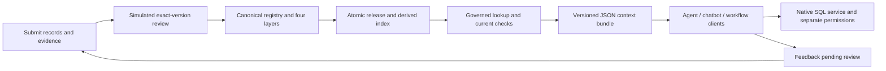

# Demonstrating the Prefrontal context layer

Use this guide to show the process behind a governed answer: where its meaning
comes from, which exact versions were reviewed, how consumers receive the same
context, and what happens when evidence or permissions change.

The walkthrough uses invented sales data. Allow 15–20 minutes. All reviewer and
release-owner actions in the executable demo are **scripted simulations**; no real
person has approved the sample records.

## What the audience will see

Open with a familiar BI question:

> “What were net sales this month compared with last month, and can I trust the
> comparison?”

Then establish the demonstration boundary:

> “That is the business journey we want to support. Today's executable example
> answers the narrower question, ‘What is September 2026 net revenue in USD?’
> It demonstrates the context lifecycle and its controls. It has one month of
> synthetic data; it does not calculate month-over-month change.”

| Capability | Status in this demonstration |
|---|---|
| Four linked context records, exact-version review, release and durable audit | Implemented in the prepared local pilot; approvals are simulated |
| Exact-ID and all-keyword lookup, including the alias `net sales` | Implemented deterministic baseline |
| Three consumers using identical governed context and a separate native SQL service | Implemented example clients named agent, chatbot and workflow |
| Source correction, stale evidence, expiry and permission/record revocation | Implemented scripted scenarios with saved evidence |
| Natural-language question understanding, conversational UI or live LLM | Not implemented |
| Previous-month data, dimensional joins and month-over-month calculation | Proposed extension |
| Three-panel question/process/evidence interface | Proposed presentation design; no such interface is implemented |
| Enterprise authentication, live warehouse/LookML integration and MCP server | Not implemented or qualified by this local pilot |

**Availability:** this documentation branch publishes this guide only. At the time
of writing, the executable `pilot/` package is in the prepared local checkout and
has not been published to this branch. Cloning the documentation branch alone does
not provide the runnable demo. Use the existing pilot checkout; do not switch,
reset or publish its branch to follow this guide. A separate decision is needed
before distributing the runtime.

The public [project overview](../README.md) and
[architecture content](../presentation-content.json) describe the broader
proposal. Their proposed capabilities are not all delivered by the local pilot.

## Prepare the demonstration

- Use a terminal and a JSON/text viewer, or an editor with side-by-side panes.
- Have Python 3.9 or later and the prepared local `pilot/` package available.
  The pilot uses only the Python standard library; no API key, model account,
  network service or enterprise dataset is needed.
- In the prepared checkout, inspect `pilot/README.md`, `pilot/sample_domain.py`,
  `pilot/demo.py`, `pilot/native_sales.py` and `pilot/fixtures/`.
- Use fresh demo evidence for interactive requests. Those requests append audit
  events to SQLite. Inspect older saved JSON files without modifying their
  database or source snapshots.
- Keep all example identities and classifications visibly labeled as fixtures.
  `--principal chatbot` selects a trusted local test identity; it is not a login.

Start in the prepared local repository:

```powershell
Set-Location 'D:\Projects\LLM-ASD-STE100'
if (-not (Test-Path -LiteralPath 'pilot/demo.py')) {
    throw 'The prepared local pilot is required; this documentation branch does not include it.'
}
python --version
python -B -m pilot.demo
if ($LASTEXITCODE -ne 0) { throw 'Demo failed; inspect the error before presenting.' }
```

The demo creates a new timestamped directory under `.validation/context-pilot/`,
copies its fixtures there, runs all eight scenarios and leaves reusable release
`r4`. It changes its copied source snapshot, not the source fixtures. Expected
console output:

```text
PASS: 3 consumers, identical context; USD 3300 -> USD 3400 after reviewed correction
PASS: 8 maintenance scenarios; durable SQLite readback; 0 LLM calls
Evidence: <absolute path to the new run's evidence.json>
```

For a slower narrated presentation, run this once before the meeting and walk
through its saved artifacts in the order below. The command is an automated
rehearsal, not an interactive approval screen.

Load the exact evidence path printed by that run:

```powershell
$evidencePath = Read-Host 'Paste the full path printed after Evidence:'
$runDirectory = Split-Path -Parent $evidencePath
$report = Get-Content -Raw -LiteralPath $evidencePath | ConvertFrom-Json
$initial = Get-Content -Raw -LiteralPath (Join-Path $runDirectory 'initial-consumers.json') | ConvertFrom-Json
$final = Get-Content -Raw -LiteralPath (Join-Path $runDirectory 'final-consumers.json') | ConvertFrom-Json
$report | Select-Object scope, contract, simulated_human_approvals, llm_calls,
    consumer_count, identical_context_bundles, verified_scenarios, active_release
```

## Walk through the process

### 1. Establish the source, grain and freshness boundary

Show `pilot/fixtures/orders.json`, `net_revenue.sql` and `domain-policy.md`.

| Source fact | Explain it this way |
|---|---|
| Workspace and period | `sales-lab`; September 2026 (`2026-09`) only |
| Grain | One row per order, identified by its order ID |
| Currency | Stored as integer USD cents; results displayed in USD |
| Population | Completed orders; cancelled orders excluded |
| Evidence binding | File paths and SHA-256 hashes bind records to source bytes |
| Validity | Records have `valid_from` and `valid_until`; the fixture grants a 30-day interval from the run's clock |

Say: “September is the data period, not a claim that this is a live or freshly
synchronized business source. The pilot checks evidence bytes and record validity.
It has no live ingestion schedule or enterprise freshness SLA.”

The initial known answer is independently inspectable:

| Order | Calculation in USD | Included amount |
|---|---|---:|
| `order-001` | 1,000 − 100 discount − 50 returns | 850 |
| `order-002` | 2,000 − 0 discount − 100 returns | 1,900 |
| `order-003` | 600 − 50 discount − 0 returns | 550 |
| `order-004` | Cancelled | Excluded |
| **Total** | **Completed orders only** | **3,300** |

### 2. Show how the four layers establish meaning

Use the chatbot's initial bundle as the evidence panel:

```powershell
$initialChatbot = $initial | Where-Object { $_.consumer -eq 'chatbot' }
$initialChatbot.context.records | ForEach-Object {
    [pscustomobject]@{
        id = $_.record.id
        version = $_.record.version
        layer = $_.record.layer
        reviewed_by = $_.reviewed_by
        content_hash = $_.content_hash
    }
}
```

| Layer and sample ID | What to point out |
|---|---|
| Data: `data:orders` | Source snapshot, period, currency, grain and evidence hash |
| Metric: `metric:net-revenue` | Approved-in-simulation definition: sum gross less discounts and returns for completed orders; bound SQL file and its revision hash |
| Ontology: `ontology:net-sales` | The phrase `net sales` names the canonical net-revenue concept in this sample domain |
| Interpretation: `interpretation:net-revenue` | Synthetic, single-currency, single-month assumptions; revenue alone establishes neither profitability nor reasons for change |

The metric and ontology depend on the data record; the interpretation depends on
the metric and ontology. These are versioned semantic dependencies, not four
separate databases.

**Dimensional relationships:** the implemented example has order grain and an
alias-to-metric relationship. It has no customer, product, region or date-dimension
tables and performs no joins. For a future dimensional BI demo, review the source
keys, join direction, one-to-many/many-to-many cardinality, compatible grain and
double-counting risks before admitting dimension-aware definitions. Do not draw
those proposed relationships as if the current fixtures contain them.

### 3. Follow admission, exact-version review and release



Say: “A reviewer approves this exact content and version, with its evidence,
dependencies, scope and validity. A changed version needs its own review. A release
owner publishes a complete approved set. Feedback is a request for review; it
does not silently change approved meaning.”

Show the `definition clarification` scenario in `$report.maintenance_scenarios`.
It submits metric and interpretation version 2, attempts an unapproved release,
keeps `r1`, then performs two simulated approvals and publishes `r2`. The old
approval is not reused. Incomplete publication also leaves the prior valid
release in place. An old release is usable only while its own records remain
valid, current and permitted.

### 4. Deliver the same governed bundle to different consumers

```powershell
$initial | Select-Object consumer, output
$initial | ForEach-Object {
    [pscustomobject]@{
        consumer = $_.consumer
        release = $_.context.release
        bundle_hash = $_.context.bundle_hash
        value_usd = $_.result.value
    }
}
```

Expected: three consumers, the same initial bundle/hash, release `r1`, and USD
3,300. The agent returns an observation and proposes owner review. The chatbot
formats a fixed September answer. The workflow evaluates the fixed threshold
`net revenue >= USD 3000` and returns a local result description. No external
business action is executed.

Point out the contract `context.bundle.v1`, canonical IDs, versions, source hashes,
reviewer labels, expiry and `recheck_at_use`. The context layer delivers meaning
and evidence. The separate toy source service executes its bound native SQL and
checks its own permissions. A context ID or copied bundle grants no source access.

The CLI accepts structured JSON, not the opening natural-language question. On the
fresh run, demonstrate a context lookup from another process:

```powershell
$request = '{"operation":"context.get","workspace":"sales-lab","metric_id":"metric:net-revenue","period":"2026-09","unit":"USD"}'
$request | python -B -m pilot.cli --database $report.database --source-root $report.source_root --principal chatbot
```

Expected envelope: `{"ok":true,"context":...}`. This retrieves context; it does
not execute the metric query. Because the automated rehearsal has already finished,
this live lookup returns final release `r4`, not the saved initial release `r1`.

To show the alias resolution, use the supported keyword search operation:

```powershell
$searchRequest = '{"operation":"context.search","workspace":"sales-lab","query":"net sales","period":"2026-09","unit":"USD"}'
$searchRequest | python -B -m pilot.cli --database $report.database --source-root $report.source_root --principal agent
```

Expected: `ok: true`, with `search.contract` equal to `context.search.v1`,
`search.candidates` containing ID/version matches and the bundle under
`search.context`. This is an exact-ID/all-keyword baseline, not semantic search,
automatic period inference or natural-language parsing. `context.get` requires the
canonical metric ID; substituting `net sales` into its `metric_id` does not resolve
the alias.

### 5. Show stale evidence and recovery through review

Inspect the recorded source-correction scenario:

```powershell
$report.maintenance_scenarios |
    Where-Object { $_.scenario -eq 'source correction' } |
    ConvertTo-Json -Depth 8
```

The script adds USD 100 to the first order's gross value in the run's copied
snapshot. Its hash changes; delivery returns `stale_source` before serving the
old definition/evidence combination. All four dependent records are identified,
resubmitted as new versions and reviewed again in simulation. Approval alone does
not change the active release. Publication of `r3` restores delivery; the native
known answer becomes USD 3,400.

Say: “This is a correction to the same September snapshot, not next-month sales
or month-over-month growth. The extra four review receipts expose a maintenance
policy decision. They do not measure four people's time.”

Do not edit the original fixtures or an older saved evidence directory during the
presentation. The automated scenario already supplies the before/after hashes,
affected records, denial and reviewed recovery.

### 6. Demonstrate denial, expiry and withdrawn interpretation

| Scripted scenario | Expected evidence and presenter explanation |
|---|---|
| Consumer permission withdrawn | `access_denied`; the workflow fixture loses its consumer role |
| Native-source permission withdrawn | `source_access_denied` from the separate native service even though context delivery is allowed |
| Validity expires | `outside_validity` after the script advances its clock by 31 days |
| Interpretation withdrawn | `revoked`, including use of a cached bundle; a newly reviewed replacement permits release `r4` |

These are separate gates. Inspect their scenario details; the script restores test
permissions and resets its clock before the final checkpoint. The native-source
denial is raised by that service and recorded in scenario details; it is not a
`context.get` error response.

An optional live context-denial request uses the fixture identity `outsider`:

```powershell
$request | python -B -m pilot.cli --database $report.database --source-root $report.source_root --principal outsider
```

Expected: `{"ok":false,"error":"access_denied"}`, without record/evidence payload.
This proves local configured behavior, not enterprise authentication or resistance
to an operator who can edit the database, grants, source files or program.

### 7. Close with evidence and the maintenance question

```powershell
$report.maintenance_scenarios |
    Select-Object scenario, status, responsible_roles, human_minutes
$final | ForEach-Object {
    [pscustomobject]@{
        consumer = $_.consumer
        release = $_.context.release
        bundle_hash = $_.context.bundle_hash
        value_usd = $_.result.value
    }
}
```

Expected final state: three identical bundles, USD 3,400, release `r4`, eight
verified maintenance scenarios and durable readback through a fresh connection.
The eight scenarios are incomplete publication, feedback, definition clarification,
source correction, consumer permission withdrawal, native-source permission
withdrawal, expiry and interpretation withdrawal/replacement.

| Artifact in the printed run directory | Use it to show |
|---|---|
| `evidence.json` | Scope, source/code hashes, scenario details, counts and explicit proof limits |
| `initial-consumers.json` / `final-consumers.json` | Identical context for three clients and the known-answer correction |
| `search-baseline.json` | Saved exact-ID and `net sales` keyword results |
| `audit.json` | Saved submission, approval, release, delivery, feedback and denial events |
| `registry.sqlite3` | Persisted records, approvals, releases, index references and events |
| `sources/` | The run's copied source snapshot and policy/SQL evidence |

The scripted run saves 60 events, including 11 simulated approvals, four releases
and four index rebuilds. Later CLI requests append events to SQLite; the saved
JSON snapshots and original counts do not refresh automatically.

Maintenance examples: source correction requires four new review receipts;
definition clarification two; interpretation replacement one. All
`human_minutes` values are null. Before a real pilot, assign source/domain,
reviewer, release, platform and consumer responsibilities and measure hands-on
time, blocked tasks, interventions and cost per accepted task. Agree how routine
data refresh differs from a source/schema/definition change.

## Proposed three-panel presentation design

This is a storyboard for explaining the process, **not a delivered interface**.
Today, arrange an editor, terminal and saved JSON side by side if helpful.

| Proposed panel | Content and transition |
|---|---|
| Question | Display the BI question, explicit month/currency and the narrower supported request; label manual selection instead of implying NLP |
| Process | Highlight source → metric → ontology → interpretation → review → release → governed delivery; show the responsible role and stop on denied gates |
| Evidence | Display source hash, grain, definition, versions, simulated review receipt, validity, bundle hash and the native answer or denial |

For a future month-over-month demonstration, admit a prior-month source and
compatible reviewed definitions first. Define calendar/fiscal boundaries,
timezone, complete/partial months, comparable populations, currency and returns
policy. Qualify native calculations for both months and handle zero/missing prior
values before showing `(current - prior) / prior`. Do not infer causation or
profitability from the comparison. No second-month values or trend explanation
are part of today's executable evidence.

## Completion checklist and remaining gaps

- [ ] The presenter identifies all data, identities and approvals as synthetic.
- [ ] The narrower September question and the proposed month-over-month journey
      are clearly distinguished.
- [ ] Source, order grain, period, currency, definition and interpretation limits
      are visible alongside evidence and exact versions.
- [ ] The audience sees three consumers with identical context and a separate
      native calculation/permission boundary.
- [ ] The presenter shows a changed version needing review, stale-source denial,
      a permission denial and reviewed recovery.
- [ ] A fresh run directory and its expected outcomes have been inspected, or an
      existing run is explicitly labeled as saved evidence.
- [ ] Maintenance counts are distinguished from unmeasured human effort.
- [ ] Proposed UI, dimensions, month-over-month analysis and enterprise integration
      are labeled as future work.

Saved local acceptance evidence from October 15, 2026 reports **42 tests passed**
and a source-bound eight-scenario replay. This is historical local evidence, not
hosted CI or product acceptance. A separate regression run is available in the
prepared checkout when needed: `python -B -m unittest pilot.test_context_pilot -v`.

Remaining qualification includes real human reviews and identities, source and
consumer adapters, field-level policies, live MCP, semantic/hybrid relevance,
concurrency and infrastructure-failure recovery, and measured staffing, operating
cost and business value. Source hashes detect bound byte changes; they do not
establish semantic truth. The local operator controls the SQLite store and audit.
Keep the pilot local; this guide does not authorize production use or exposing its
CLI as a network service.
