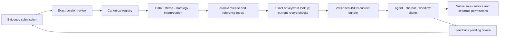

# Governed-context pilot

This runnable skeleton tests the context lifecycle without an LLM. One invented
sales domain has four linked records, one native SQL metric, and three deterministic
consumer clients. Python 3.9+ and its standard library are sufficient.

The goal is to establish what the context layer does, how consumers use it, and
which maintenance actions it creates. This is local pilot evidence, not acceptance
of the entire proposed product or an enterprise integration.

## Architecture review

The current proposal is the **14-node architecture in
[`presentation-content.json`](../presentation-content.json)** at repository base
revision `21bcd3f89ac19bc51e918c20cc822e483bf5b8ee`. The standalone diagram under
`docs/architecture/` is older, uncommitted supporting material. The current proposal
includes a derived search index and governed retrieval.

Keep these design decisions:

- One canonical registry owns identity, version and review history. The four layers
  describe meaning; they can share a database.
- Approval binds the complete record, including evidence, dependency versions,
  classification and validity. Changed or derived meaning needs its own review.
- Native query logic stays with the source service. Context IDs grant no access to
  that source and do not authorize consumer actions.
- The search index contains derived references. Delivery resolves current records
  and checks their dependencies, permissions and sources again.
- A failed release preserves the prior pointer. The prior release is deliverable
  only while its content remains current, approved and permitted.

The proposal leaves operating policy to qualify: who may certify a source, how
frequent data refresh differs from a definition change, who resolves conflicts,
which permissions can cross adapters, and what maintenance burden is acceptable.
Neither evidence hashes nor deterministic checks establish semantic truth.



The decision model is replaced by deterministic fixture preparation. The three
clients are runnable examples, not a real agent, chatbot application, or workflow
platform. The JSON-lines interface is a local transport; it is not an MCP server.

## Run and inspect

From the canonical repository:

```powershell
python -m unittest pilot.test_context_pilot -v
python -m pilot.demo
```

The demo prints its unique evidence directory under `.validation/context-pilot/`.
It keeps `registry.sqlite3`, source snapshots, initial/final consumer outputs,
search results, `audit.json`, and `evidence.json`. These are ignored runtime
artifacts. They remain available for durable readback after the process exits.

The starting known answer is **USD 3300**: completed orders contribute 850, 1900
and 550; the cancelled order is excluded. After the scripted source correction,
the independently checked expected result is **USD 3400**. The context registry
delivers definitions and evidence; `native_sales.py` executes the bound SQL.

The final reusable checkpoint is release `r4`, with all three clients receiving
the same context. Scripted expiry and permission revocation are reset before that
checkpoint; the withdrawn interpretation is replaced by a newly reviewed version.

To consume it from another terminal or Codex session, use the database and source
paths printed in `evidence.json`:

```powershell
$request = '{"operation":"context.get","workspace":"sales-lab","metric_id":"metric:net-revenue","period":"2026-09","unit":"USD"}'
$request | python -m pilot.cli --database '<run-directory>\registry.sqlite3' --source-root '<run-directory>\sources' --principal chatbot
```

Keyword lookup uses the same process:

```json
{"operation":"context.search","workspace":"sales-lab","query":"net sales","period":"2026-09","unit":"USD"}
```

Search returns an approved context bundle with candidate IDs and versions. It
supports exact IDs or all query keywords, with controlled no-match and ambiguous
outcomes. It does not guess an ID, period or currency. Hybrid search and semantic
relevance are not implemented or qualified.

## Public boundary

`context.get` returns `{ "ok": true, "context": ... }`. The `context.bundle.v1`
envelope contains workspace, release, manifest hash, requested metric/period/unit,
four records with IDs/versions/content hashes/reviewer receipts/evidence, expiry,
and a bundle hash. Each record retains its owner, scope and dependency versions.
Denied requests return only `{ "ok": false, "error": "..." }`.

Clients depend on JSON request/response ports. They do not inspect registry tables.
The sample source service checks its own query permissions and rechecks the current
context before executing. A copied bundle is a snapshot, not a permission token.
No cross-product access transfer is assumed.

Limits: 4096 UTF-8 bytes per request, 8192 per record, 16 records per release,
160000 per delivered bundle, and 1 MiB per bound evidence file. The toy native
query has a finite SQLite execution budget. SQLite commits release, index,
active pointer and audit changes together. File sources are checked at delivery
and again at native use; coordinated distributed source snapshots are unqualified.

## Responsibilities and maintenance

You retain architecture ownership. The other entries are responsibilities to
assign in a real pilot, not people who have already accepted the role.

| Role | Owns | Maintenance trigger and required action |
|---|---|---|
| Architecture owner | Contract, boundaries, acceptance and expansion decision | Review contract or policy changes; decide whether evidence permits expansion |
| Source/domain owner | Source meaning, certified query, units, grain and exceptions | Identify changed sources and affected records; submit corrections with evidence |
| Domain reviewer | Meaning and evidence for an exact version | Approve, reject or request changes; review derived explanations independently |
| Release owner | Complete release acceptance and recovery | Publish approved dependency sets; hold unsafe releases; authorize replacements |
| Platform maintainer | Registry, access configuration, index, audit and recovery | Restore persisted state, rebuild derived references and diagnose denied delivery |
| Consumer owner | Adapter, source permissions, task acceptance and action authority | Qualify each adapter; recheck context at use; submit feedback; authorize its actions |

The eight demo scenarios replay failed publication, feedback, definition
clarification, source correction, consumer permission withdrawal, native-source
permission withdrawal, expiry, and interpretation withdrawal/replacement.
`evidence.json` records actual audit event counts and affected records per scenario.
It labels all approvals as simulated and leaves `human_minutes` null.

This deliberately conservative model requires **four new review receipts** after
one source snapshot correction, **two** after the definition clarification, and
**one** after the interpretation replacement. Each accepted release rebuilds four
index references. A denial does not repair or silently republish a record.

That exposes a material maintenance decision: reviewing all derived records after
every row refresh may be too expensive for frequently changing data. Before a real
data pilot, distinguish owner-approved source/schema/definition changes from data
refreshes admitted under an explicitly approved validation and freshness policy.
This skeleton implements the conservative behavior; it does not grant automatic
approval to future data changes.

Use the next supervised rehearsal to measure hands-on minutes, reviews, blocked
tasks, adapter interventions and index rebuilds. Report cost per accepted task
including that effort. Machine rehearsal time is not human maintenance time or a
load benchmark. Staffing, recurring cost and business return remain unmeasured.

## Evidence and next pilot gate

The acceptance suite covers exact-content/version approval, rejection, dependency
closure and cycles, transaction rollback, restart/readback, source drift/removal,
reviewed correction, expiry, revocation, cached-use checks, workspace/classification
denial, native-source permission independence, bounded inputs, malformed data,
query budgets, reference-index corruption/rebuild, and separate-process JSON use.

The single completion checklist and validation record remain in
[`research-shortlist.md`](../research-shortlist.md), under "Context lifecycle pilot".
No second project tracker is introduced.

Before moving from this skeleton to an operating pilot, assign a source owner,
reviewer and release owner; choose representative tasks and maintenance changes;
agree acceptance thresholds and an effort ceiling; and qualify the real identity,
source and consumer adapters. Shared infrastructure or production work requires
its own approval. LLM evaluation can follow separately if it answers a remaining
question; it is not required to test the lifecycle demonstrated here.

Trusted local principals are test configuration, not authentication. The local
operator can edit the database, source files, grants and audit; this is not a
tamper-resistant system. Enterprise authorization, field-level policies, real MCP,
LookML/warehouse integration, hybrid relevance, distributed concurrency, recovery
under infrastructure failure, live operating cost and human governance remain
unverified. Do not expose this CLI as a network service.
